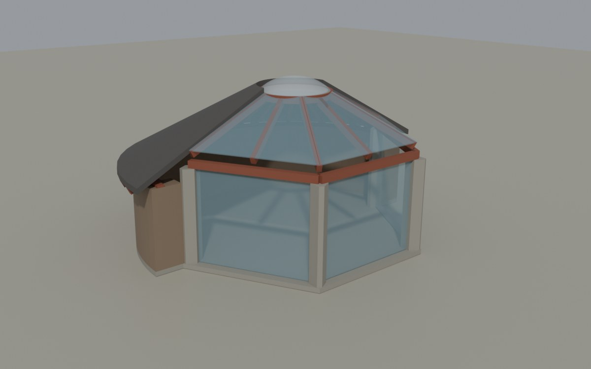

# ArchitectWorks

Turns an architect's blueprint set into a Blender model that lands in Unreal Engine at the right size and facing the right way.

It works the way a careful person would: read the drawings into a plain-text description of the building first, argue with that text until it matches the sheets, then build geometry from the text. The sheets are allowed to be vague. The geometry is not.



*Pavilion A of the example house: hexagonal and half glass, with a stone arc and a conical shingle roof. It was generated from [`pavilion_a.yaml`](projects/example-house/pavilion_a.yaml) and rendered headless in Blender 5.2. The four columns, three doors and twenty-three conical-roof rafters are instances of one mesh each.*

## Phase 0 status

Phase 0 proves the back half: a hand-written spec, through Blender, into Unreal. The gate is *the pavilion measures right in Unreal, faces the right way and has collision*.

| Gate item | Status |
| --- | --- |
| Spec → exact geometry, with every value traced to a sheet | Done: 15 components, 52 placements |
| Cross-checks from the drawings (dimension chains, typical rules, levels) | Done: 10 pass, 3 real conflicts reported (below) |
| `.blend` with shared meshes, UCX collision, materials, review collections | Done |
| FBX exporters attached to the `.blend`, run headless | Done: File > Export All Collections reproduces every mesh |
| Every FBX re-imported into Blender and compared with the spec | Done: 15/15 match, scale 1, hull counts equal |
| Unreal import and placement script | Written, run here only against a stand-in `unreal` module |
| **Unreal import test** (size, axes, collision, Nanite, every actor's bounds) | **Needs a machine with Unreal 5.8**: see [In Unreal](#in-unreal) |

## Quick start

Python 3.13 on Linux x86-64, Windows or Apple silicon. Those are the platforms with a Blender 5.2 `bpy` wheel.

```bash
python3.13 -m venv .venv && . .venv/bin/activate
pip install -e ".[dev,blender]"        # bpy is ~400 MB
aw build projects/example-house/pavilion_a.yaml --preview
pytest -q
```

Without the `bpy` wheel, point `BLENDER` at a Blender 5.2 LTS binary. The Blender step only needs Blender's own Python:

```bash
BLENDER=/path/to/blender aw build projects/example-house/pavilion_a.yaml
```

Output lands in `projects/example-house/out/pavilion_a/`:

| File | What it is |
| --- | --- |
| `resolved.json` | Every mesh and placement in metres, plus checks and derived values |
| `generated.blend` | The model. Rebuilt on every run, so don't edit it; link it from another file |
| `unreal/meshes/*.fbx` | One FBX per unique mesh, `UCX_` collision hulls inside |
| `unreal/manifest.json` | Placements and expected bounds in Unreal space (cm, left-handed) |
| `unreal/import_unreal.py`, `unreal/check_import.py` | Import into the open level, then test it |
| `preview/example-house.glb`, `.png` | Quick look without Blender or Unreal |
| `blender_report.json` | Export mode, file hashes, re-import results, FBX header |

## In Unreal

Unreal 5.8 with the Python Editor Script Plugin enabled. Open a level, then in **Output Log > Cmd**:

```
py "C:/path/to/out/pavilion_a/unreal/import_unreal.py"
py "C:/path/to/out/pavilion_a/unreal/check_import.py"
```

Or headless:

```
UnrealEditor-Cmd.exe MyProject.uproject -ExecutePythonScript="C:/path/to/unreal/import_unreal.py" -unattended -nosplash
UnrealEditor-Cmd.exe MyProject.uproject -ExecutePythonScript="C:/path/to/unreal/check_import.py" -unattended -nosplash
```

`check_import.py` logs PASS or FAIL and writes `check_report.json` next to the manifest. The yellow L near the pavilion is the handedness marker. It is 2 m along X, 1 m along Y and 1.5 m tall, so a mirrored, swapped or 100×-scaled import is caught and named, for example: "X and Y are swapped: 'Force Front X Axis' is probably on".

The import script was written against Unreal 5.8 documentation and has not run in a real editor yet. Any engine API that differs is caught and listed in `import_log.json`, not silently skipped. Expect a round of fixes the first time it meets a real editor; that is the point of phase 0.

## How it works

```
sheets ──► Building Spec (YAML) ──► resolve ──► resolved.json ──► blendgen (inside Blender) ──► .blend + FBX
            hand-written in phase 0    plain Python, tested           no geometry decisions           │
                                                                                                      ▼
                                                     manifest.json ──► import_unreal.py ──► check_import.py
```

- **`src/architectworks/spec/`**: the schema. Lengths are written as on the drawings (`7'-7 3/4"`) and parsed to exact fractions, so sums of dimension strings close exactly. Every value carries `src`: sheet, basis and the words on the sheet. Basis ranks dimensioned > rule > measured > assumed.
- **`src/architectworks/resolve/`**: patterns expand into placed components. `radial_pavilion` turns one entry into columns, headers, doors, walls, slab, roof, rafters, ring and skylight. Every mesh is built and checked (closed, positive volume, planar faces, convex hulls) in plain Python.
- **`blendgen/build.py`**: runs inside Blender and imports nothing from this package, so stock Blender runs it. It lays out collections, shares mesh data between placements, attaches FBX exporters, exports, then re-imports every file to check it.
- **`unreal/`**: the import and check scripts, copied into every bundle.
- **`schema/building-spec.schema.json`**: point your editor at it for completion while writing specs (`aw schema` regenerates it).

## What the resolver found in the example

The drawings mostly agree with themselves. Five dimension chains on the foundation plan close exactly, and the hexagon "typ." dimensions follow their geometry to within 1/16". Three things do not agree, and the model says so instead of quietly picking one:

1. **Compression ring radius.** The 30° pitch and the 110'-9" top of ring put the ring at 2'-8 7/8" radius, while the elevation scales to about 2'-3". The geometry uses the derived value.
2. **Conical roof pitch.** The dimensioned top of masonry (105'-8", from D-3) and top of ring give 27.8°, while the general note says 30°. The geometry follows the dimensioned levels.
3. **A 2" step where the glass roof meets the shingle roof** at the end columns follows from 1 and 2. Detail D-2 is cited but missing from the set, and would probably settle all three.

## Findings about the tools

- **Blender 5.2's collection exporter does not create its output folder.** On a failed write it still reports `FINISHED` and logs "Exported". The pipeline creates folders first and checks every file itself.
- **File > Export All Collections skips collections excluded from the view layer.** Component collections are hidden from the viewport instead, which still exports.
- **The FBX files declare 1 unit = 1 m (`UnitScaleFactor` 100) and Y up.** Objects stay at scale 1 through a round trip. Unreal is expected to mirror Y on import; the marker test confirms or refutes that.

## Conventions

| Concern | Rule |
| --- | --- |
| Units | Blender in metres at unit scale 1.0; FBX "FBX Units Scale"; Unreal converts to cm |
| Axes | Blender Z up. Unreal placement: location (100x, −100y, 100z); quaternion (x, y, z, w) → (−x, y, −z, w) |
| Names | `SM_<code>_<Component>_<Variant>`, `M_<Material>`, `UCX_<mesh>_NN` |
| Collision | Convex pieces built with the mesh; curved walls and roofs are split into segments |
| Nanite | On for opaque meshes, off for glass and acrylic |
| Datum | The spec's `datum` level (F.F. 100'-0") is z = 0 |

## Known limits of phase 0

- One pavilion at an assumed position and rotation; the plan's center point coordinates are not read yet.
- Not modelled: column notches, door frames, trellis, gutters and footings.
- Materials are flat-color placeholders named for Unreal.
- Nothing reads the sheets automatically yet; that is phase 2.

The five sheet photos in `projects/example-house/sheets/` are a third party's drawings. Keep this repository private unless you have permission to publish them.
