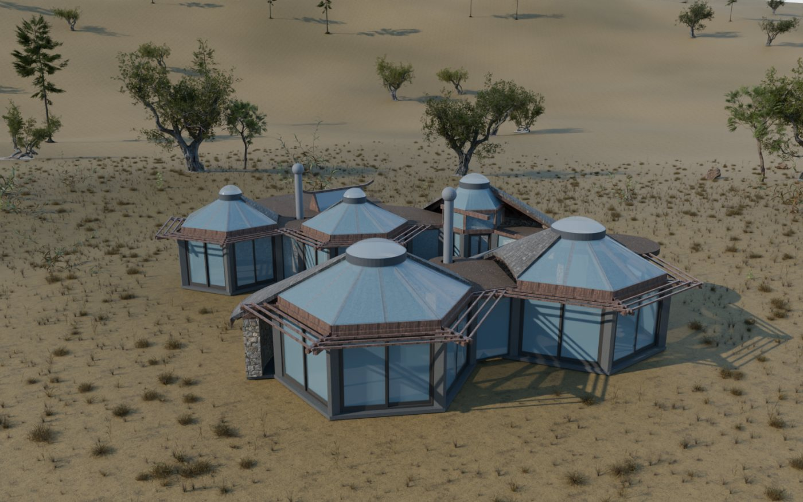
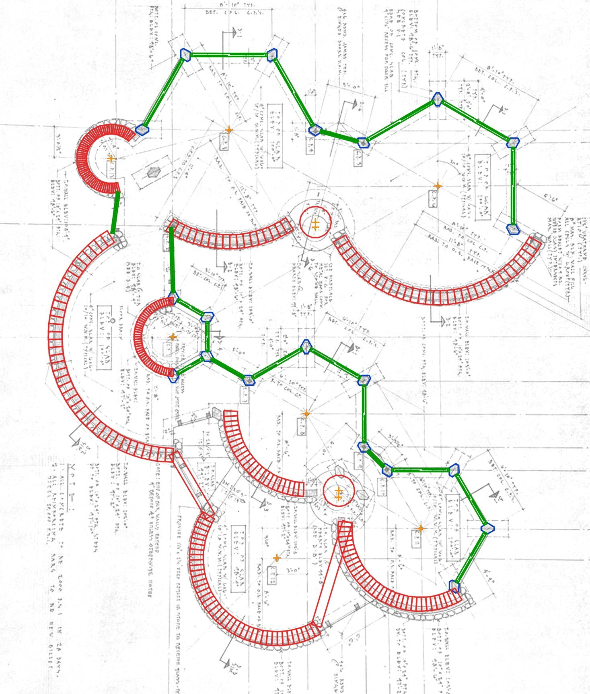
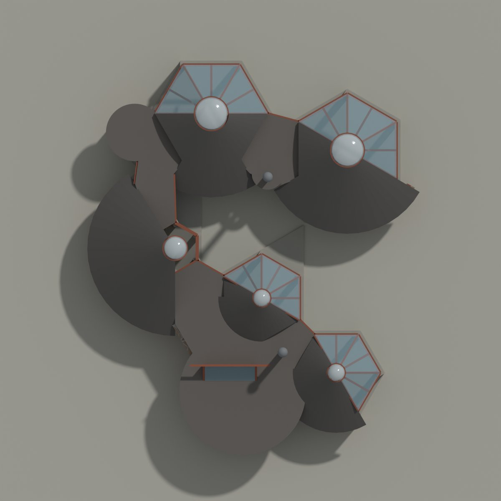
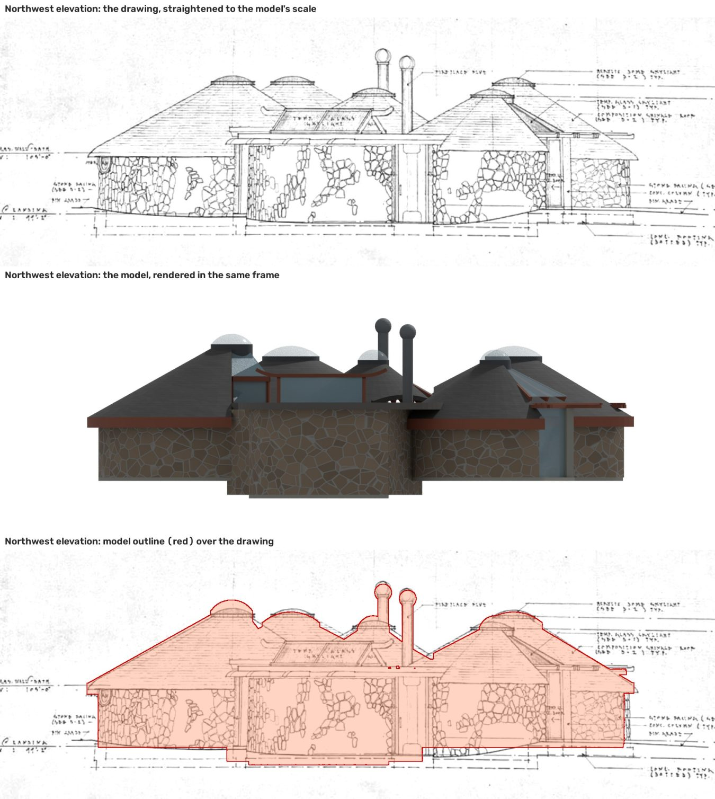
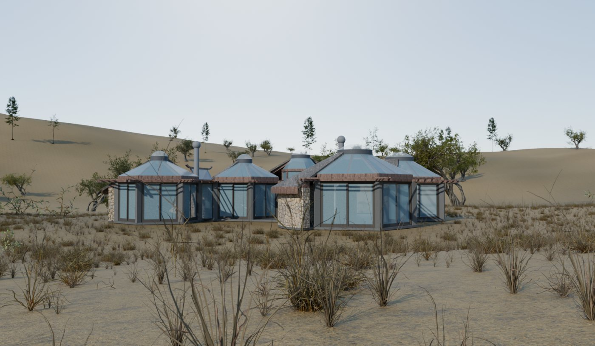
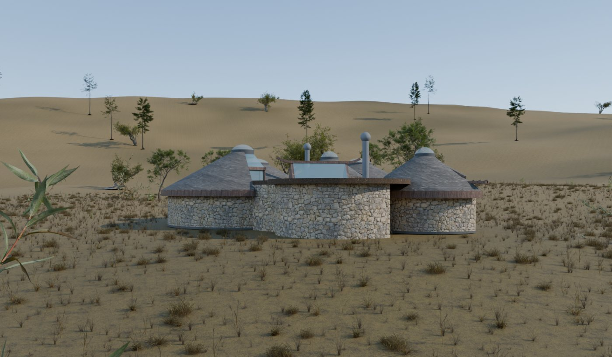
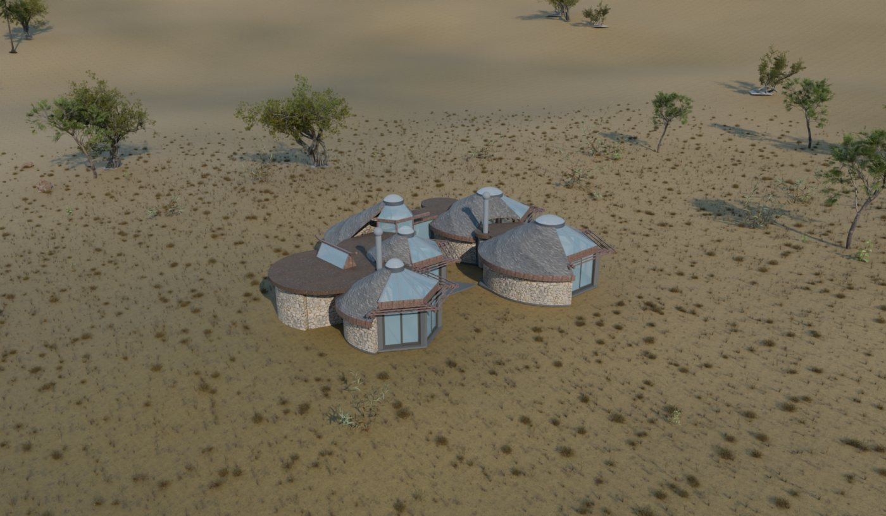

# ArchitectWorks

Turns an architect's blueprint set into a Blender model that lands in Unreal Engine at the right size and facing the right way.

It works the way a careful person would: read the drawings into a plain-text description of the building first, argue with that text until it matches the sheets, then build geometry from the text. The sheets are allowed to be vague. The geometry is not.



*The example house, generated from [`house.yaml`](projects/example-house/house.yaml) and rendered headless in Blender 5.2, from the stone side: six pavilions, a stair tower, the music room, two round cores with their flues, the flat roofs, trellises and glazed links between them. 101 unique meshes, 328 placements.*

## Phase 2 status: reading the sheets

Phase 2 teaches the pipeline to read a sheet instead of being told what is on it. The gate: a draft made from the foundation plan photo, scored against phase 1's hand-written spec as the answer key. Detection proposes, Claude names, and the dimensions written on the drawing win over anything measured in pixels.

| Step | Status |
| --- | --- |
| Detect candidate marks (column marks, center points) | Done: 75 blobs and 327 line convergences. 21 of the 22 hand-placed calibration points are found within 4 px. The miss is the music room center, drawn as an open circle |
| Views for the reader: crops with a sheet-pixel grid and numbered marks | Done |
| The reader: Claude looks at the sheet, zooms with two tools, answers in a fixed JSON schema | Written, and tested against a scripted stand-in. **Not yet run against the API**: it needs `ANTHROPIC_API_KEY` |
| Draft builder: a reading becomes control points and pavilions, every value with its basis | Done |
| Scorer: a draft against the answer key | Done |
| **Gate**: Claude's own reading, drafted and scored | Waiting for an API key |

**The baseline.** Phase 1's hand reading ([`foundation-plan.hand.json`](projects/example-house/readings/foundation-plan.hand.json)), put through the same draft builder, scores **22 of 26 (85%)**. All 9 center points are found, 3 of them exact and 6 within 2". Four of the five pavilions are right in every respect: sides, side length, rotation and which sides are glazed. What it misses, and why:

- **The top dimension chain sits 1¾" from where the key has it.** The column marks say one thing and the living room center says another. The draft goes with the columns and flags it for review; the key went with the center.
- **The living room pavilion is missing.** The hand reading lists no columns for it, so there is nothing to build it from.
- **The stair tower and the two round cores are 2½" to 7" off.** Nothing on the sheet dimensions them, so they are measured through the photo's perspective, and they say so.

That is the bar Claude's reading has to clear, or explain why the key is wrong.

### Running the reader

```bash
pip install -e ".[sheets,reader]"
export ANTHROPIC_API_KEY=...            # or an environment variable on the cloud environment
aw detect projects/example-house/sheets/foundation-plan.jpg
aw read   projects/example-house/sheets/foundation-plan.jpg
aw draft  projects/example-house/readings/foundation-plan.claude.json \
          projects/example-house/sheets/foundation-plan.jpg \
          --score projects/example-house/house.yaml
```

The reader runs `claude-opus-5-5` at effort `high` with adaptive thinking, structured output against [`schema.py`](src/architectworks/reader/schema.py), prompt caching, and the API's server-side refusal fallback. It may take up to 40 turns, each one a few zoomed views of about 1,600 image tokens. A run should cost a dollar or three per sheet; that is an estimate, not a measurement.

Every API response is recorded under `readings/recordings/<sheet>/`, keyed by a hash of the request. Running `aw read` again with the same sheet, marks and prompt replays the recording. `aw read --offline` never calls the API at all. Commit the recordings and a reading can be reproduced by anyone, for free.

| Module | Job |
| --- | --- |
| [`reader/detect.py`](src/architectworks/reader/detect.py) | Candidate marks: `M` blobs (center-surround filter), `C` convergences (many line directions meeting) |
| [`reader/views.py`](src/architectworks/reader/views.py) | What the reader sees: crops with a grid labelled in sheet pixels and the marks circled |
| [`reader/claude.py`](src/architectworks/reader/claude.py) | The reader: prompt, tools, tool loop, recordings |
| [`reader/draft.py`](src/architectworks/reader/draft.py) | Reading to draft: chains give exact values, inked lines link them to features, a projective fit places the rest |
| [`reader/score.py`](src/architectworks/reader/score.py) | Draft against the answer key, after aligning the two origins |

## Phase 1 status: the whole house, checked against the drawings

Phase 1 models the whole house from a hand-written spec. Its gate is that the model's outlines agree with the drawings and the house can be walked in Unreal. The first half needs no Unreal, and is mostly done for the foundation plan:

| Item | Status |
| --- | --- |
| Every pavilion center placed from the dimension chains | Done: 6 of 9 center points are dimensioned, 3 measured |
| All ten dimension chains on the foundation plan close | Done, with two readings settled by the fit (below) |
| Photo of the plan fitted to the model | Done: 22 points, 1.3" mean residual, 2.6" worst |
| Model drawn over the straightened plan and scored | Done: 94% of column outline, 86% of glazing and 67% of wall outline lands on ink (72% before the two new stone walls, below) |
| Flat roofs between the pavilions and over the music room | Done (step 2): outlines from the roof plan, height from the NW elevation |
| Music room skylight, fireplace flues | Done (step 2): the flues check out on both elevations to within 4 px |
| Stone walls that read as stone | Done (step 2): rubble pattern in the previews, two missing stone walls added |
| Outlines checked against the elevations | Done (step 2): both elevations fitted and laid over orthographic renders |
| Interior walls | Not yet: needs the floor plan |
| Walk it in Unreal | Waiting for a machine with Unreal |

<table><tr>
<td></td>
<td></td>
</tr><tr>
<td><em>The model over the straightened foundation plan: walls red, columns blue, glazing green, center points orange.</em></td>
<td><em>The model from straight above, same orientation.</em></td>
</tr></table>

### How the plan is read

The photo is fitted to the model, not the other way round. [`foundation-plan.calib.yaml`](projects/example-house/sheets/foundation-plan.calib.yaml) lists the pixel positions of 22 named points: center points and columns. Their plan positions come from the spec, so the fit's residuals measure how well spec and drawing agree. The fitted photo is then straightened into plan coordinates, and the model is drawn over it.

That loop settled three readings the photo alone could not:

- **The right chain's "3'-6"" is 3'-5".** That closes its 11'-8" chain, and 3'-5" is half the small hexagon's side.
- **The left chain's "11'-4"" is 11'-8".** The fitted plan measures the round core within ½" of 11'-8"; 11'-4" misses by 3½".
- **The 8'-0" and 11'-8" arc radii are to the face of the 12" block.** The stone facing sits outside the block. The living room and music room arcs are not lettered; they measure 12'-4" and 8'-6".

The glass link between the two north pavilions is lettered 5'-0". The model gets 5'-0" from the pavilion centers and sides alone.

### Step 2: roofs, flues and the elevations

The roof framing plan is fitted to the same plan coordinates from its center points (5" worst residual). The elevations are fitted per view: across from the skylight domes, which stand on the pavilion centers, and up from the lettered level lines. That turns out to be enough to say which way each elevation looks: the southwest one looks along plan −X, the northwest one along plan +Y.

The fireplace flues are the independent check. Nothing about them went into the fits. Their plan positions come from the circles on the roof plan, and both elevations then draw them within 4 px of where the fits put them. Each flue stands 6" to 8" south of the round core it rises from, still inside it.

| What | Where it comes from |
| --- | --- |
| Three flat roofs: the strip between the north pavilions, the north-west hall and stair tower, and one over the music room and the halls round it | Outlines from named points on the roof plan; top at 107'-2" from D-3 (the NW elevation scales 107'-4"). Each is cut back wherever a pavilion roof rises above it, so the two meet along the line where one passes through the other. "ROOFING ON FLAT SURFACES TO BE 4 PLY BUILT-UP ROOF" |
| Glass skylight on the music room roof | Length, rise and ridge-beam overhang from the NW elevation; where it sits north to south is assumed. "ALL SKYLIGHTS TO BE 2 LAYERS OF TEMPERED 1/4" GLASS" |
| Two fireplace flues with ball caps | Plan from the roof plan and both elevations; tops at 115'-3" and 114'-8", 12" pipe, 19" ball |
| Stone walls from the living room to the music room and from the music room to the south-east pavilion | The NW elevation draws stone there without a break |

`aw build --preview` now also renders the model straight on from each fitted elevation's direction, and lays the drawing over it:



[`docs/views`](docs/views) has finished shots from each blueprint view: each elevation drawn above the model in the same view and scale, an eye-level shot from the same side, and the roof framing plan beside the model seen from straight above.

[The southwest elevation](docs/images/elevation-southwest.jpg) compares the same way, and [the glass side](docs/images/house-glass-side.jpg) of the house now shows the flat roofs and flues too.

A second pass, after review against the drawings, added:

| What | Where it comes from |
| --- | --- |
| The skylight is a gable: glass on both slopes, triangular ends 2'-8" across, the ridge beam's tips turned up 7" | NW elevation |
| Redwood trellis outside every glazed side: a pair of 4x4 brackets along the rafter at each column, reaching 3'-4", and 2x2 slats across them | D-1: "2-4x4 TRELLIS SUPPORT BRACKET", "3'-4" TO O.S. OF BRACKET"; the roof plan draws three slats to a side |
| A glass lantern on the living room: posts and fixed glass above the header to a beam at 109'-8", glass facets up to the ring | SW elevation ("FIXED GL.") |
| Steel compression rings standing 5" above the roofing as the skylight curb, clear domes on top | The owner's direction; the elevations draw the band |
| A fascia over the rafter tails, and D-3's trim from the top of masonry up to the roof | D-3: "1"x10" WD. TRIM EA SIDE OF PL." |
| Shingle courses on the conical roofs in the previews | "ROOFING ON 30° SLOPES TO BE COMPOSITION TAB LOCK SHINGLES" |
| Flat roof top 107'-2" and 8" thick | D-3: 5'-8" of masonry, 10" of sill and beam, 8" of roof |
| Glass facets meet the round steel ring along a level line, not in scallops | The elevations draw the ring's lower edge level |
| Continuous blocking from the top of header up to the glass roof | D-1: "CONT. BLK. CUT FROM 2x4" |
| Every glazed bay is a framed sliding pair: two sashes on two tracks with meeting stiles; the glazed links get framed fixed panes | Elevations: "TEMP. GLASS SLIDING DOOR"; D-1: "GLASS SLIDING DOOR FRAME" (frame sizes assumed) |
| One long beam at 109'-8" under the living room's lantern roof, running 6'-2" north of its center | SW elevation |

What the comparison still shows: the model's music room sits about 2'-0" further south than the southwest elevation draws it; the living room's east side is drawn with a glazed gable the model does not have; the living room's cone still stops at the edge of its stone arc, so its underside shows beside the lantern; the slats are lettered "2'-0" O.C." but drawn about 1'-0" apart, and the model follows the drawing; the flat roofs' 1/4" per foot drainage taper is not modelled.

### Textures and the site

The previews can now show the house textured, in a landscape. There is no site plan, so the landscape is invented, and the spec's `site` section says so (basis `assumed`).

- **Textures.** Each material can name a photographic texture set from [Poly Haven](https://polyhaven.com) (CC0): rubble stone (`stone_wall`), redwood (`rough_wood`, tinted toward redwood), shingles (`roof_slates_02`, darkened toward composition shingles), worn concrete, gravel on the built-up roofs, and withered grass for the ground. The ground gets large, slow patches of light and dark, because a 2 m photo repeated across a hillside averages to one flat colour. Texture coordinates are in metres at true scale. Conical roofs are mapped so shingle courses run level round them, and curved stone wraps round its wall instead of stretching.
- **What comes from the drawings.** Finished grade is 99'-7" (the elevations' FIN. GRADE line, about 5" under the bedroom floor). The ground falls to the north, as their grade lines fall toward the landing and the sunken music room. True north comes from the roof plan's arrow, and it agrees with which way each elevation looks.
- **What is invented.** The landscape is Northern California oak savanna: rolling golden grassland beyond a level pad, hills on the horizon, oaks (broadleaf stand-ins scaled up), firs on the far slopes, shrubs, bunch grass and boulders. The grass is Poly Haven's bunch grass with its own *Dead Amount* control turned most of the way up, because nothing in a Northern California September is green except the trees and the people who forgot to water. The sun is placed for 38.5° N on 20 September at 4:30 pm, over the glazed south-west side.
- **Composition.** Trees, shrubs and rocks keep out of the wedge between each eye-level camera and the house, the way an architectural photographer stands somewhere the oak isn't. Grass doesn't, and it thins out toward the edge of its band instead of stopping at a line you could trip over from the air.

```bash
aw assets projects/example-house/house.yaml   # about 750 MB, checked against Poly Haven's md5s, into assets/ (git-ignored)
aw build projects/example-house/house.yaml --preview
```

| From the south-west | From the north-west |
| --- | --- |
|  |  |



Without the download everything still builds, with flat or procedural materials. The site never goes to Unreal's FBX set: Unreal should build its own landscape and foliage from the same `site` data.

## Phase 0 status

Phase 0 proves the back half: a hand-written spec, through Blender, into Unreal. The gate is *the pavilion measures right in Unreal, faces the right way and has collision*.

| Gate item | Status |
| --- | --- |
| Spec → exact geometry, with every value traced to a sheet | Done: 15 components, 52 placements |
| Cross-checks from the drawings (dimension chains, typical rules, levels) | Done: 10 pass, 3 real conflicts reported (below) |
| `.blend` with shared meshes, UCX collision, materials, review collections | Done |
| FBX exporters attached to the `.blend`, run headless | Done: File > Export All Collections reproduces every mesh |
| Every FBX re-imported into Blender and compared with the spec | Done: 15/15 match, scale 1, hull counts equal |
| Unreal import and placement script | Written, run here only against a stand-in `unreal` module |
| **Unreal import test** (size, axes, collision, Nanite, every actor's bounds) | **Needs a machine with Unreal 5.8**: see [In Unreal](#in-unreal) |

## Quick start

Python 3.13 on Linux x86-64, Windows or Apple silicon. Those are the platforms with a Blender 5.2 `bpy` wheel.

```bash
python3.13 -m venv .venv && . .venv/bin/activate
pip install -e ".[dev,blender,sheets,reader]"   # bpy is ~400 MB; sheets adds OpenCV and SciPy
aw build projects/example-house/house.yaml --preview
pytest -q
```

`pavilion_a.yaml` is the phase 0 spec, a single pavilion. `house.yaml` is the whole house.

Without the `bpy` wheel, point `BLENDER` at a Blender 5.2 LTS binary. The Blender step only needs Blender's own Python:

```bash
BLENDER=/path/to/blender aw build projects/example-house/pavilion_a.yaml
```

Output lands in `projects/example-house/out/<spec name>/`:

| File | What it is |
| --- | --- |
| `resolved.json` | Every mesh and placement in metres, plus checks and derived values |
| `generated.blend` | The model. Rebuilt on every run, so don't edit it; link it from another file |
| `unreal/meshes/*.fbx` | One FBX per unique mesh, `UCX_` collision hulls inside |
| `unreal/manifest.json` | Placements and expected bounds in Unreal space (cm, left-handed) |
| `unreal/import_unreal.py`, `unreal/check_import.py` | Import into the open level, then test it |
| `preview/example-house.glb`, `.png` | Quick look without Blender or Unreal |
| `blender_report.json` | Export mode, file hashes, re-import results, FBX header |
| `sheets/*.overlay.jpg`, `*.check.json` | The model over each calibrated sheet, and the agreement scores |
| `sheets/*.rectified.png` | The sheet straightened into plan coordinates; also a reference plane in the `.blend` |
| `preview/example-house-stone-side.png` | The other side of the house, where the stone walls are |
| `preview/elevation-looking*.png` | Orthographic elevations, one per fitted elevation sheet (with `--preview`) |
| `sheets/*.compare.jpg`, `*.elevation-fit.json` | Each drawn elevation over the matching render, and the fit that lines them up |

## In Unreal

Unreal 5.8 with the Python Editor Script Plugin enabled. Open a level, then in **Output Log > Cmd**:

```
py "C:/path/to/out/pavilion_a/unreal/import_unreal.py"
py "C:/path/to/out/pavilion_a/unreal/check_import.py"
```

Or headless:

```
UnrealEditor-Cmd.exe MyProject.uproject -ExecutePythonScript="C:/path/to/unreal/import_unreal.py" -unattended -nosplash
UnrealEditor-Cmd.exe MyProject.uproject -ExecutePythonScript="C:/path/to/unreal/check_import.py" -unattended -nosplash
```

`check_import.py` logs PASS or FAIL and writes `check_report.json` next to the manifest. The yellow L near the pavilion is the handedness marker. It is 2 m along X, 1 m along Y and 1.5 m tall, so a mirrored, swapped or 100×-scaled import is caught and named, for example: "X and Y are swapped: 'Force Front X Axis' is probably on".

The import script was written against Unreal 5.8 documentation and has not run in a real editor yet. Any engine API that differs is caught and listed in `import_log.json`, not silently skipped. Expect a round of fixes the first time it meets a real editor; that is the point of phase 0.

## How it works

```
sheets ──► Building Spec (YAML) ──► resolve ──► resolved.json ──► blendgen (inside Blender) ──► .blend + FBX
            hand-written in phase 0    plain Python, tested           no geometry decisions           │
                                                                                                      ▼
                                                     manifest.json ──► import_unreal.py ──► check_import.py
```

- **`src/architectworks/spec/`**: the schema. Lengths are written as on the drawings (`7'-7 3/4"`) and parsed to exact fractions, so sums of dimension strings close exactly. Every value carries `src`: sheet, basis and the words on the sheet. Basis ranks dimensioned > rule > measured > assumed.
- **`src/architectworks/resolve/`**: patterns expand into placed components. `radial_pavilion` turns one entry into columns, headers, doors, stone arcs, roof, rafters, ring and skylight. `stone_ring`, `round_mass` and `link` cover towers, cores and the walls between named points. Slabs are one per floor level, unioned from every element's footprint. Every mesh is built and checked (closed, positive volume, planar faces, convex hulls) in plain Python.
- **`src/architectworks/sheets.py`**: fits a photographed sheet to the model, straightens it and scores the model against it.
- **`blendgen/build.py`**: runs inside Blender and imports nothing from this package, so stock Blender runs it. It lays out collections, shares mesh data between placements, attaches FBX exporters, exports, then re-imports every file to check it.
- **`unreal/`**: the import and check scripts, copied into every bundle.
- **`schema/building-spec.schema.json`**: point your editor at it for completion while writing specs (`aw schema` regenerates it).

## What the resolver found in the example

The drawings mostly agree with themselves. Five dimension chains on the foundation plan close exactly, and the hexagon "typ." dimensions follow their geometry to within 1/16". Three things do not agree, and the model says so instead of quietly picking one:

1. **Compression ring radius.** The 30° pitch and the 110'-9" top of ring put the ring at 2'-8 7/8" radius, while the elevation scales to about 2'-3". The geometry uses the derived value.
2. **Conical roof pitch.** The dimensioned top of masonry (105'-8", from D-3) and top of ring give 27.8°, while the general note says 30°. The geometry follows the dimensioned levels.
3. **A 2" step where the glass roof meets the shingle roof** at the end columns follows from 1 and 2. Detail D-2 is cited but missing from the set, and would probably settle all three.

## Findings about the tools

- **Blender 5.2's collection exporter does not create its output folder.** On a failed write it still reports `FINISHED` and logs "Exported". The pipeline creates folders first and checks every file itself.
- **File > Export All Collections skips collections excluded from the view layer.** Component collections are hidden from the viewport instead, which still exports.
- **The FBX files declare 1 unit = 1 m (`UnitScaleFactor` 100) and Y up.** Objects stay at scale 1 through a round trip. Unreal is expected to mirror Y on import; the marker test confirms or refutes that.

## Conventions

| Concern | Rule |
| --- | --- |
| Units | Blender in metres at unit scale 1.0; FBX "FBX Units Scale"; Unreal converts to cm |
| Axes | Blender Z up. Unreal placement: location (100x, −100y, 100z); quaternion (x, y, z, w) → (−x, y, −z, w) |
| Names | `SM_<code>_<Component>_<Variant>`, `M_<Material>`, `UCX_<mesh>_NN` |
| Collision | Convex pieces built with the mesh; curved walls and roofs are split into segments |
| Nanite | On for opaque meshes, off for glass and acrylic |
| Datum | The spec's `datum` level (F.F. 100'-0") is z = 0 |

## Known limits

- The roofs between pavilions, the music room's flat roof, the stair tower roof and the living room roof east of the hearth are not modelled. The floor plan and detail D-2 would settle most of them.
- Interior walls and the remaining connections between pavilions are not read. The slab between pavilions is inferred by closing gaps under 10 feet.
- The small pavilions' ring radius is assumed (1'-6"), so their roof pitches come out steep and are reported as conflicts.
- The two round cores may be fireplace flues that rise above the roof. They are modelled to the top of masonry.
- Not modelled: column notches, door frames, trellis, gutters and footings.
- Materials are flat-color placeholders named for Unreal.
- The sheets are read by hand with tooling; reading them automatically is phase 2.

The five sheet photos in `projects/example-house/sheets/` are a third party's drawings. Keep this repository private unless you have permission to publish them.
